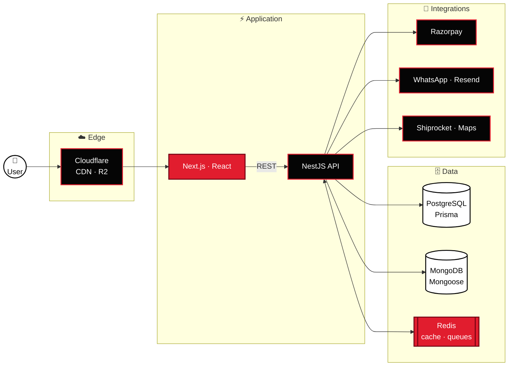
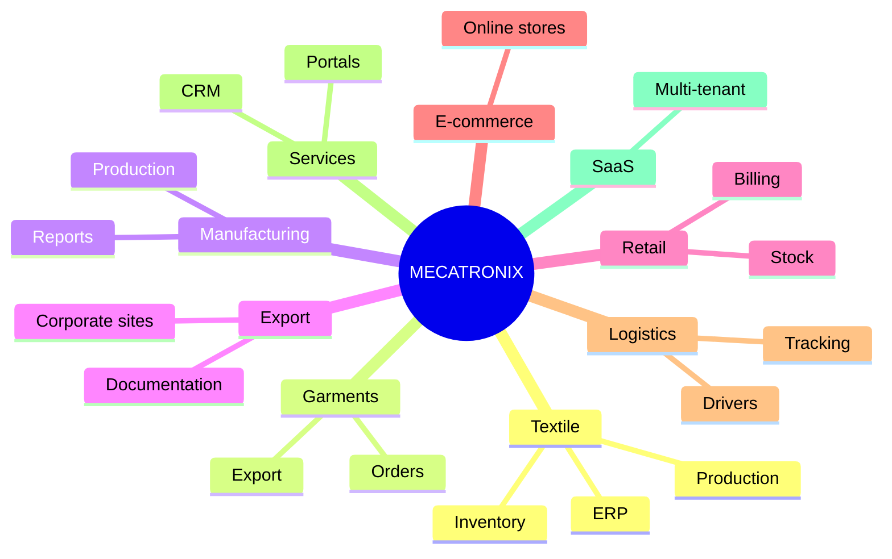

<!-- ═══════════════════════════════════════════════════════════════ -->
<!--  MECATRONIX · README v3 · "Meca AI Command Center"              -->
<!--  Palette: #050505 black · #E11D2E red · #FFFFFF white            -->
<!--  Requires: ./assets/meca-ai.svg next to this file                -->
<!-- ═══════════════════════════════════════════════════════════════ -->

<div align="center">


</div>

<table>
<tr>
<td width="42%" align="center" valign="middle">



</td>
<td width="58%" valign="middle">


### Hi, I’m **Meca AI** 👋

I’m the copilot at **Mecatronix Software Development**.
Let me walk you through what we build, how we build it,
and why businesses across Tamil Nadu trust us with their operations.


<a href="https://www.mecatronix.one/"></a>
&nbsp;

&nbsp;


</td>
</tr>
</table>


<!-- ═════════════════════ meca://about ═════════════════════ -->

## `meca://about`

> [!NOTE]
> **Meca AI:** Most software makes you change how you work. We do it the other way around — we study your workflow first, then engineer the system to fit it.

<table>
<tr>
<td align="center" width="25%"><h3>🧭</h3><b>Understand</b><br/><sub>the business</sub></td>
<td align="center" width="25%"><h3>🏗️</h3><b>Architect</b><br/><sub>the system</sub></td>
<td align="center" width="25%"><h3>⚙️</h3><b>Engineer</b><br/><sub>with modern tools</sub></td>
<td align="center" width="25%"><h3>🔁</h3><b>Automate</b><br/><sub>the workflow</sub></td>
</tr>
</table>

```yaml
mecatronix:
  delivers:
    - faster business operations
    - real-time information
    - secure data management
    - better operational control
    - workflow automation
    - infrastructure that scales
    - code that stays maintainable
```

<!-- ═════════════════════ meca://services ═════════════════════ -->

## `meca://services`

> [!TIP]
> **Meca AI:** Six product lines, one engineering team. Pick the one that sounds like your problem.

<table>
<tr>
<td width="33%" valign="top">


#### 🌐 Web platforms
<sub>Websites engineered for speed and trust.</sub>

Corporate · Textile & manufacturing · Export · Catalogues · Portals · Landing pages

</td>
<td width="33%" valign="top">


#### 🛒 E-commerce
<sub>Online selling, start to finish.</sub>

Products · Categories · Cart · Checkout · Payments · Orders · Coupons · Shipping

</td>
<td width="33%" valign="top">


#### 🏭 ERP systems
<sub>Your whole operation in one place.</sub>

Production · Inventory · Sales · Purchase · Workers · Suppliers · Expenses · Reports

</td>
</tr>
<tr>
<td width="33%" valign="top">


#### 🧾 Billing & POS
<sub>Fast counters, clean ledgers.</sub>

Invoices · POS · Thermal printing · WhatsApp invoices · Customer ledger · Payments

</td>
<td width="33%" valign="top">


#### 📱 Applications
<sub>An app for every role on your team.</sub>

Customer · Driver · Worker · Admin · Field apps · Dashboards · Management portals

</td>
<td width="33%" valign="top">


#### ⚙️ Custom software
<sub>For workflows nobody else has.</sub>

SaaS · Multi-tenant · Internal platforms · APIs · Automation · Legacy modernization

</td>
</tr>
</table>

<!-- ═════════════════════ meca://stack ═════════════════════ -->


## `meca://stack`

<div align="center">


<sub>
<b>UI</b> shadcn/ui · TanStack Query · Zod · Zustand &nbsp;|&nbsp;
<b>API</b> REST · JWT · RBAC &nbsp;|&nbsp;
<b>Ops</b> Cloudflare R2 · PM2
</sub>

</div>

<!-- ═════════════════════ meca://architecture ═════════════════════ -->

## `meca://architecture`

> [!NOTE]
> **Meca AI:** Here’s how a typical Mecatronix system is wired. Every box is something we build, run and monitor.



<sub>Hosted on Vercel or VPS with Docker · Nginx · PM2.</sub>

<!-- ═════════════════════ meca://industries ═════════════════════ -->

## `meca://industries`



<!-- ═════════════════════ meca://process ═════════════════════ -->

## `meca://process`

> [!TIP]
> **Meca AI:** Nine steps, and the last one loops back to the first. Software is never “done” — it grows with you.

<div align="center">


</div>

<details>
<summary><b>Open the full process log</b></summary>
<br/>

```console
$ meca run --project=your-business

[01/09] DISCOVER       ✔ business, users, current workflow
[02/09] REQUIREMENTS   ✔ modules, features, permissions, rules
[03/09] ARCHITECTURE   ✔ frontend, backend, database, APIs, infra
[04/09] UI / UX        ✔ screens designed for the people using them
[05/09] ENGINEERING    ✔ production development
[06/09] QA             ✔ functional, API, responsive, edge cases
[07/09] OPTIMIZE       ✔ performance, security, reliability
[08/09] DEPLOY         ✔ cloud / VPS with monitoring
[09/09] EVOLVE         ↺ support, improve, scale

✔ system live. business scaling.
```

</details>

<!-- ═════════════════════ meca://standards ═════════════════════ -->

## `meca://standards`

<table>
<tr>
<td width="50%" valign="top">

```ts
// frontend.config.ts
export const frontend = {
  typeSafe: true,
  components: "reusable",
  rendering: ["RSC", "SSR", "SSG"],
  loading: ["lazy", "dynamic imports"],
  images: "optimized",
  responsive: true,
  seo: true,
  a11y: true,
};
```

</td>
<td width="50%" valign="top">

```ts
// backend.config.ts
export const backend = {
  architecture: "modular",
  validation: "DTO",
  auth: ["JWT", "RBAC"],
  rateLimit: true,
  logging: "centralized",
  errors: "handled",
  queries: "indexed",
  env: "protected",
  monitoring: true,
};
```

</td>
</tr>
</table>

<!-- ═════════════════════ meca://security ═════════════════════ -->


## `meca://security` · `meca://performance`

> [!IMPORTANT]
> **Meca AI:** Security and speed aren’t add-ons we bolt on at the end. They’re designed in from the first line of code.

<table>
<tr>
<td width="50%" valign="top">

**🔐 Security scan**

```text
● JWT + HTTP-only cookies ....... ON
● Role-based access (RBAC) ...... ON
● Request validation ............ ON
● Input sanitization ............ ON
● Password hashing .............. ON
● Rate limiting ................. ON
● Secure headers + CORS ......... ON
● Env & DB access control ....... ON
● Production logging ............ ON
```

</td>
<td width="50%" valign="top">

**⚡ Performance scan**

```text
● Server Components + SSR ....... ON
● Static generation ............. ON
● Lazy loading + dynamic imports  ON
● Image optimization ............ ON
● CDN delivery + compression .... ON
● Indexing + query tuning ....... ON
● Redis caching ................. ON
● API optimization .............. ON
● Production monitoring ......... ON
```

</td>
</tr>
</table>

<!-- ═════════════════════ meca://why ═════════════════════ -->

## `meca://why`

<div align="center">

| | |
|:---|:---|
| 🎯 **Business first** — we learn the workflow before we pick the tech | 🛠️ **Custom built** — shaped by your real operations |
| 📈 **Built to scale** — ready for growth from day one | ⚡ **Speed matters** — performance is a requirement |
| 🧩 **Modern stack** — production-ready, typed end to end | ♾️ **Long-term** — systems that evolve with you |

</div>

<!-- ═════════════════════ FOOTER ═════════════════════ -->

<div align="center">

<br/>


<a href="https://www.mecatronix.one/"></a>


<sub>© Mecatronix Software Development · Tamil Nadu, India</sub>

</div>
