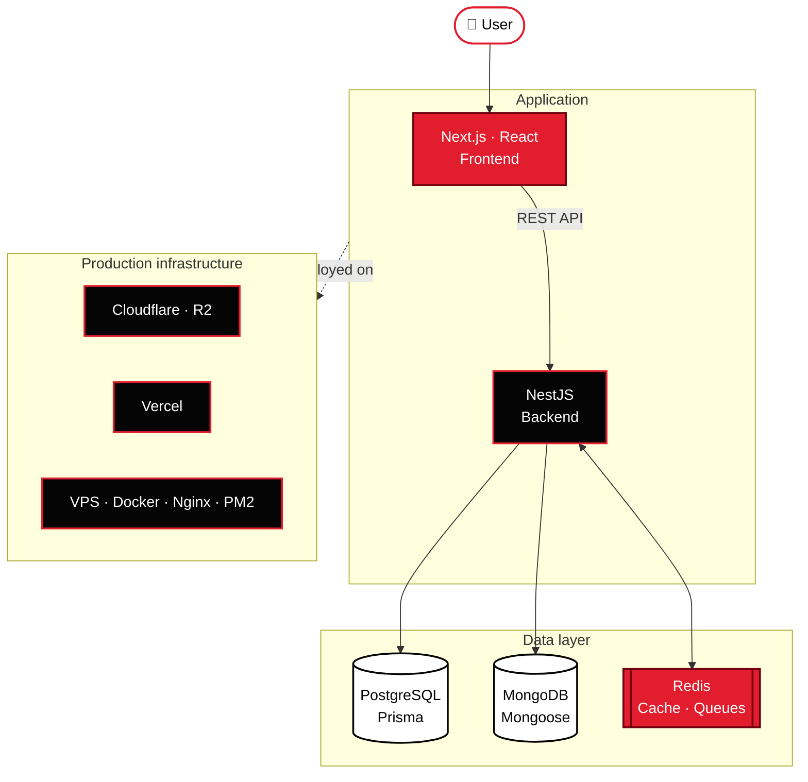
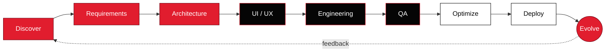

<!-- ═══════════════════════════════════════════════════════════════ -->
<!--  MECATRONIX · README v2 · Palette: #050505 / #E11D2E / #FFFFFF   -->
<!-- ═══════════════════════════════════════════════════════════════ -->

<div align="center">

<!-- HERO: venom header with slide-in title -->


<!-- Typing terminal line -->
<a href="https://www.mecatronix.one/">
  
</a>

<br/>

<a href="https://www.mecatronix.one/"></a>


</div>


<!-- ═══════════════════ ABOUT ═══════════════════ -->

<table>
<tr>
<td width="62%" valign="top">

### ▍ Who we are

**Mecatronix** designs and engineers digital products for businesses that run on real operations — mills, factories, exporters, shops and fleets.

We start with how your business actually works, then build the software around it. Not the other way round.

```diff
+ Faster operations          + Real-time information
+ Secure data management     + Workflow automation
+ Better operational control + Infrastructure that scales
+ Code that stays maintainable for years
```

</td>
<td width="38%" valign="top" align="center">

<br/>


<sub><code>$ mecatronix --core-check</code></sub>

</td>
</tr>
</table>

<div align="center">

</div>

<!-- ═══════════════════ SERVICES ═══════════════════ -->

## ▍ What we engineer

<sub>Tap any block to expand.</sub>

<details open>
<summary><b>🌐 Web platforms</b> — modern business websites built for speed</summary>
<br/>

`Corporate sites` `Textile & manufacturing sites` `Export websites` `Product catalogues` `Business portals` `Landing pages`

</details>

<details>
<summary><b>🛒 E-commerce</b> — complete online selling, end to end</summary>
<br/>

`Product management` `Categories & cart` `Checkout & payments` `Orders & coupons` `Shipping`

</details>

<details>
<summary><b>🏭 ERP systems</b> — one place to run production, stock and people</summary>
<br/>

`Production` `Inventory` `Sales & purchase` `Workers & suppliers` `Expenses` `Reporting`

</details>

<details>
<summary><b>🧾 Billing & POS</b> — fast counters, clean ledgers</summary>
<br/>

`Invoice generation` `POS & thermal printing` `WhatsApp invoices` `Customer ledger` `Payments & reports`

</details>

<details>
<summary><b>📱 Applications</b> — purpose-built apps for every role</summary>
<br/>

`Customer apps` `Driver apps` `Worker & admin apps` `Field apps` `Dashboards` `Management portals`

</details>

<details>
<summary><b>⚙️ Custom software</b> — built around workflows nobody else has</summary>
<br/>

`SaaS & multi-tenant systems` `Internal platforms` `Automation & APIs` `Dashboards` `Legacy modernization`

</details>

<br/>

<div align="center">

| ⚡ **Fast** | 🔐 **Secure** | 📈 **Scalable** | 🧠 **Smart** |
|:---:|:---:|:---:|:---:|
| Speed is a requirement, not a bonus | Security designed in from day one | Ready for the next 10× | Workflows that run themselves |

</div>


<!-- ═══════════════════ STACK ═══════════════════ -->

## ▍ Technology core

<div align="center">

<table>
<tr>
<td align="center" width="25%"><b>Frontend</b><br/><br/></td>
<td align="center" width="25%"><b>Backend</b><br/><br/></td>
<td align="center" width="25%"><b>Data</b><br/><br/></td>
<td align="center" width="25%"><b>Infra</b><br/><br/></td>
</tr>
</table>


</div>

<!-- ═══════════════════ ARCHITECTURE (Mermaid renders natively on GitHub) ═══════════════════ -->

## ▍ Architecture



<!-- ═══════════════════ INTEGRATIONS ═══════════════════ -->

## ▍ Integration layer

<div align="center">

| Payments | Messaging | Logistics | Media & storage | Maps |
|:---:|:---:|:---:|:---:|:---:|
|  | <br/> |  | <br/> |  |

<sub>…plus any third-party API your business already depends on.</sub>

</div>

<!-- ═══════════════════ INDUSTRIES ═══════════════════ -->

## ▍ Industries we serve

<div align="center">


</div>

<details>
<summary><b>See the full list</b></summary>
<br/>

| Sector | What we build |
|---|---|
| 🧵 **Textile** | Production · Inventory · Catalogue · ERP |
| 👕 **Garments** | Products · Export · Order management |
| 🏭 **Manufacturing** | Production · Inventory · Reports |
| 📦 **Export** | Corporate platforms · Documentation |
| 🛒 **Retail** | Billing · Stock · Customers |
| 🛍️ **E-commerce** | Online commerce platforms |
| 🚚 **Logistics** | Drivers · Delivery · Tracking |
| 🧾 **Billing** | POS · Invoices · Reports |
| 💼 **Services** | Websites · CRM · Portals |
| ☁️ **SaaS** | Multi-tenant cloud systems |

</details>

<!-- ═══════════════════ PIPELINE ═══════════════════ -->

## ▍ How a project moves



<details>
<summary><b>What happens at each stage</b></summary>
<br/>

```text
01  DISCOVER       business, users, how work happens today
02  REQUIREMENTS   modules, features, permissions, business rules
03  ARCHITECTURE   frontend, backend, database, APIs, infrastructure
04  UI / UX        screens designed around the people who use them
05  ENGINEERING    production-grade development
06  QA             functional, API, responsive, edge cases
07  OPTIMIZE       performance, security, reliability
08  DEPLOY         cloud or VPS, with monitoring in place
09  EVOLVE         support, improve, scale — then loop back
```

</details>

<!-- ═══════════════════ STANDARDS ═══════════════════ -->

## ▍ Engineering standards

<table>
<tr>
<td width="50%" valign="top">

#### Frontend

- [x] Type-safe from component to API call
- [x] Component architecture & reusable UI
- [x] Server Components, SSR & static generation
- [x] Dynamic imports & lazy loading
- [x] Image optimization
- [x] Responsive on every screen
- [x] SEO & accessibility

</td>
<td width="50%" valign="top">

#### Backend

- [x] Modular architecture
- [x] DTO validation on every request
- [x] Authentication, authorization & RBAC
- [x] Rate limiting
- [x] Centralized logging & error handling
- [x] Indexed, optimized queries
- [x] Protected environments & monitoring

</td>
</tr>
</table>

<div align="center">

</div>

## ▍ Security

<div align="center">

```diff
- Unvalidated input        + Request validation & input sanitization
- Plain-text passwords     + Password hashing
- Open endpoints           + JWT · HTTP-only cookies · RBAC
- Unlimited requests       + Rate limiting
- Leaky responses          + Secure headers · strict CORS
- Exposed secrets          + Environment protection
- Blind production         + Production logging & DB access control
```

</div>

## ▍ Performance

<div align="center">

| Layer | Techniques |
|---|---|
| **Rendering** | Server Components · SSR · Static generation |
| **Loading** | Lazy loading · Dynamic imports · Image optimization |
| **Delivery** | CDN · Compression |
| **Data** | Indexing · Query optimization · Redis caching |
| **Operations** | API optimization · Production monitoring |

</div>

<!-- ═══════════════════ WHY ═══════════════════ -->

## ▍ Why Mecatronix

<table>
<tr>
<td align="center" width="33%">🎯<br/><b>Business first</b><br/><sub>We learn the workflow before we pick the technology.</sub></td>
<td align="center" width="33%">🛠️<br/><b>Custom built</b><br/><sub>Software shaped by your real operations, not a template.</sub></td>
<td align="center" width="33%">📈<br/><b>Built to scale</b><br/><sub>Architecture that is ready for growth on day one.</sub></td>
</tr>
<tr>
<td align="center" width="33%">⚡<br/><b>Speed matters</b><br/><sub>Performance is treated as a requirement.</sub></td>
<td align="center" width="33%">🧩<br/><b>Modern stack</b><br/><sub>Production-ready tools, typed end to end.</sub></td>
<td align="center" width="33%">♾️<br/><b>Long-term thinking</b><br/><sub>Systems that evolve with your business.</sub></td>
</tr>
</table>

<!-- ═══════════════════ FOOTER ═══════════════════ -->

<div align="center">


<a href="https://www.mecatronix.one/">
  
</a>

<br/>

<a href="https://www.mecatronix.one/"></a>

<br/><br/>

<sub><code>think</code> ▸ <code>engineer</code> ▸ <code>automate</code> ▸ <code>scale</code></sub>

<br/>

<sub>© Mecatronix Software Development · Tamil Nadu, India</sub>

</div>
